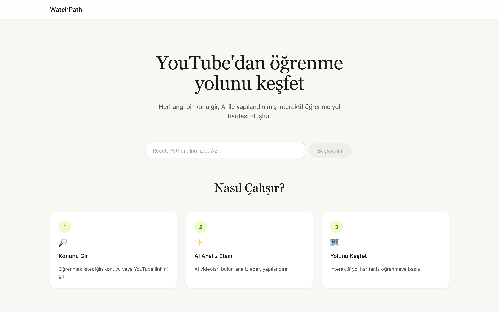
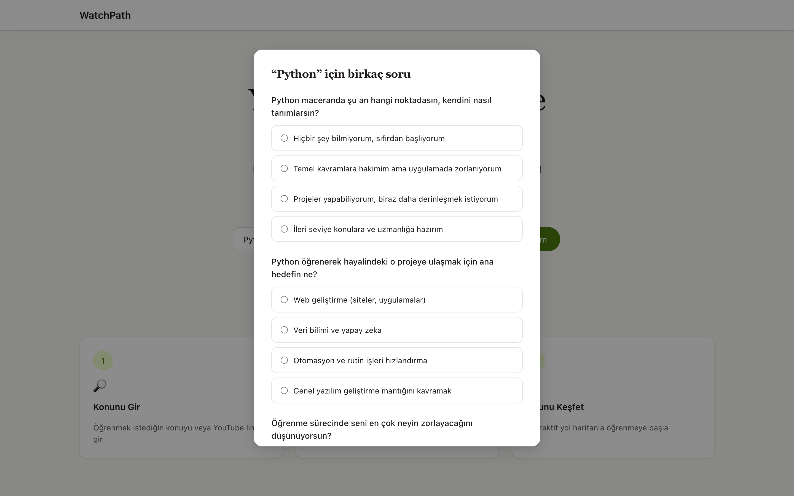
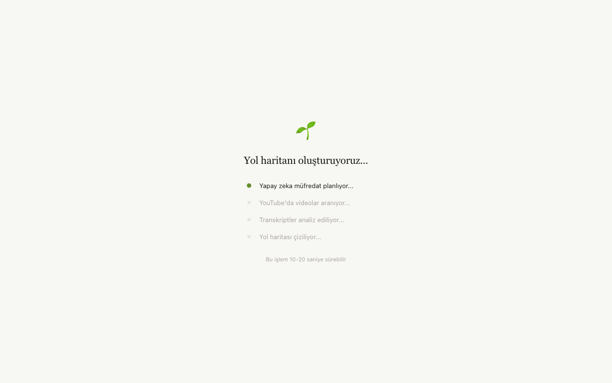
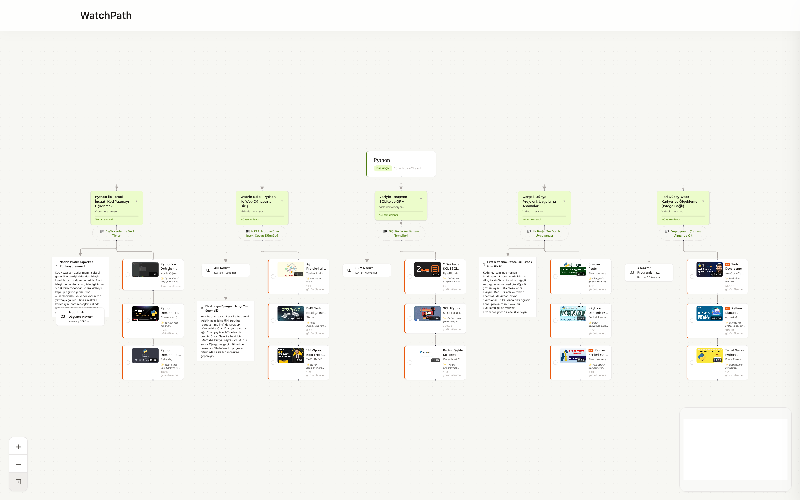
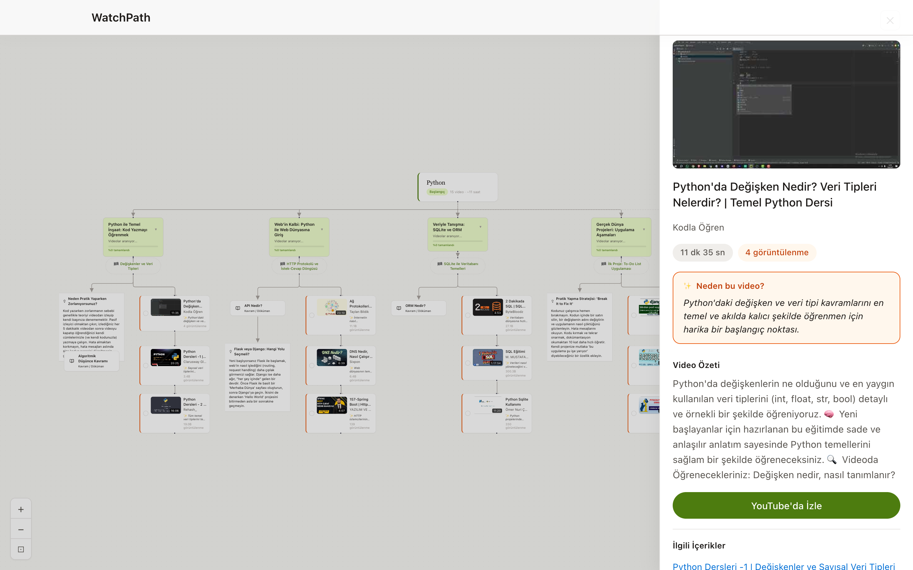
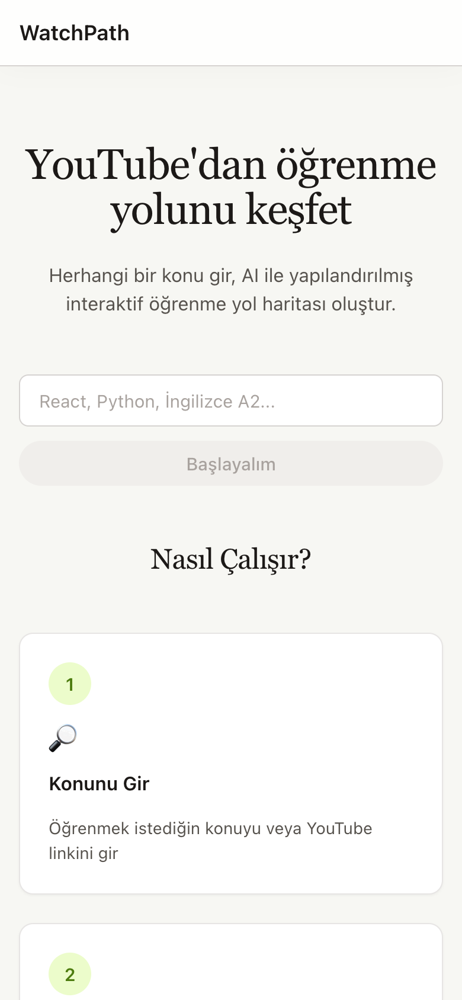
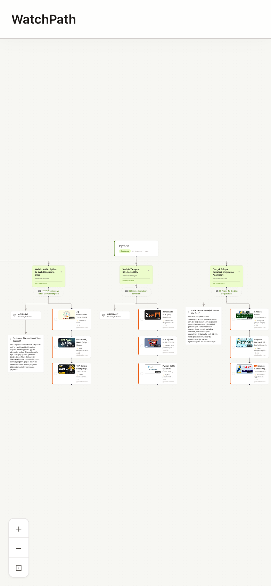

# WatchPath 🌿

> YouTube videolarını Gemini AI ile analiz edip kişiselleştirilmiş interaktif öğrenme ağaçları çıkaran yeni nesil eğitim platformu.

[](https://watchpath-two.vercel.app)
[](https://watchpath-two.vercel.app)

---

## Canlı Arayüz ve Özellik Galerisi

### 1. Akıllı Arama & Ana Sayfa
Kullanıcının öğrenmek istediği konuyu girdiği ve popüler öğrenme rotalarının listelendiği ana sayfa.



### 2. AI Onboarding & Seviye Belirleme Anketi
Gemini API ile kullanıcının mevcut seviyesini, hedefini ve zorlandığı noktaları belirleyen dinamik anket diyaloğu.



### 3. Yapay Zeka Müfredat ve Transkript Analiz Hattı
Arka planda YouTube videolarını filtreleyen, transkriptleri analiz eden ve müfredat düğümlerini oluşturan gerçek zamanlı üretim akışı.



### 4. İnteraktif React Flow Yol Haritası
Dagre layout ile dengelenmiş, dallara ayrılan ve yakınlaştırma / kaydırma kontrolleri sunan interaktif ağaç yapısı.



### 5. Video İnceleme ve AI Tavsiye Paneli
Seçilen düğüm için seçilmiş video, izleme süresi, yapay zeka tavsiye gerekçesi ("Neden bu video?") ve doğrudan video oynatma paneli.



### 6. Mobil Deneyim (Responsive)
Mobil cihazlar için optimize edilmiş ana sayfa ve dokunmatik zihin haritası deneyimi.

| Mobil Ana Sayfa | Mobil Yol Haritası |
|---|---|
|  |  |

---

## Sistem Mimarisi & Yetenekler

1. **Konu Girişi & Hedef Tespiti**: Kullanıcı konuyu yazar veya YouTube oynatma listesi linki iletir.
2. **Kişiselleştirilmiş Anket**: Kullanıcının deneyim seviyesine göre sorular dinamik üretilir.
3. **Müfredat Ağacı Üretimi**: Gemini modelleri konuyu hiyerarşik modüllere ve alt başlıklara böler.
4. **YouTube Semantik Eşleme**: Konuya en uygun video içerikleri belirlenir ve neden seçildiği özetlenir.
5. **Görselleştirme**: React Flow üzerinde zihin haritası olarak çizilir, mini-map ve seviye takibi sunulur.

## Teknoloji Yığını

- **Frontend**: Next.js 14+ (App Router, TypeScript, Tailwind CSS)
- **Görselleştirme & Canvas**: React Flow (`@xyflow/react`) + dagre layout
- **Yapay Zeka**: Google Gemini API
- **Veritabanı & Backend**: Supabase (PostgreSQL)
- **Dağıtım**: Vercel

## Dokümanlar

| Dosya | İçerik |
|---|---|
| [product_brief.md](./product_brief.md) | Ürün özeti, problem, hedef kullanıcı |
| [spec.md](./spec.md) | Teknik şartname (DB, API, pipeline) |
| [design_system.md](./design_system.md) | Toprak Bahçe renk, tipografi, bileşen tanımları |
| [component_architecture.md](./component_architecture.md) | Node tipleri, canvas deneyimi, component ağacı |
| [implementation_plan.md](./implementation_plan.md) | 5 günlük sprint planı |
| [task.md](./task.md) | Görev listesi (TODO) |

## Kurulum ve Çalıştırma

```bash
git clone https://github.com/keskinEvren/watchpath.git
cd watchpath
npm install
npm run dev
```

## Lisans

MIT
