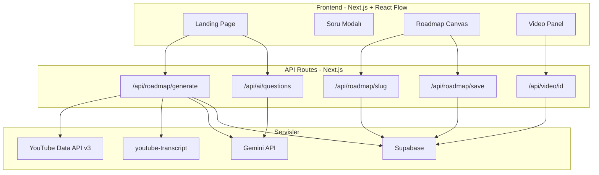
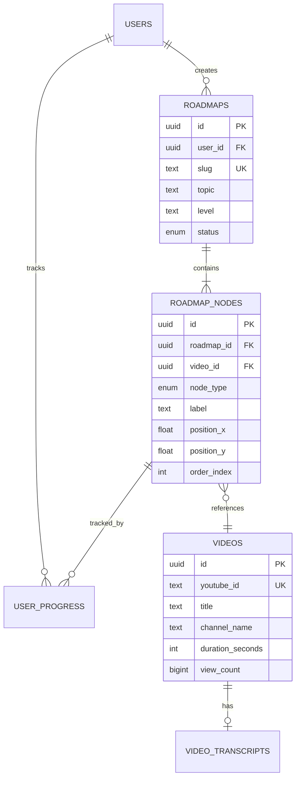
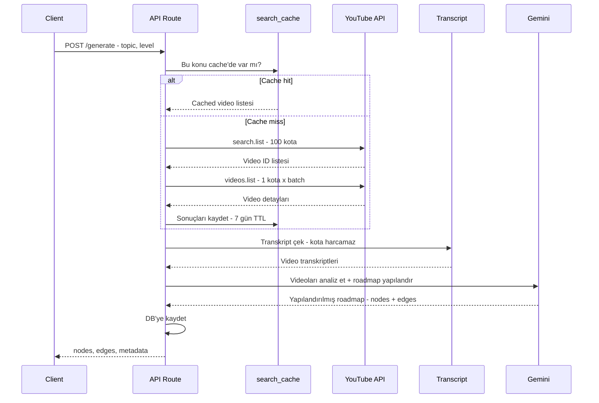
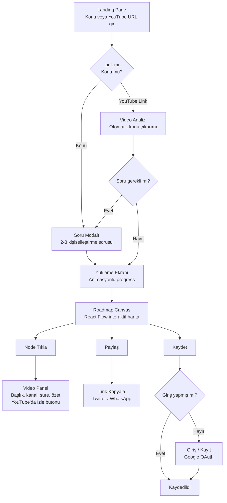

# Teknik Şartname (Spec): WatchPath

> **Girdi:** [product_brief.md](file:///Users/evren/Documents/GitHub/watchpath/product_brief.md)
> **Tarih:** 2026-06-24
> **Durum:** Onaylandı (Autoplan Review sonrası güncellenmiş)

---

## 1. Mimari Genel Bakış



---

## 2. Veritabanı Şeması (Supabase / PostgreSQL)

### 2.1 videos - YouTube Video Cache

Amaç: YouTube API çağrılarını minimize etmek. Bir video bir kez çekilir, cache'lenir.

```sql
CREATE TABLE videos (
  id            UUID PRIMARY KEY DEFAULT gen_random_uuid(),
  youtube_id    TEXT UNIQUE NOT NULL,
  title         TEXT NOT NULL,
  channel_name  TEXT NOT NULL,
  channel_id    TEXT NOT NULL,
  thumbnail_url TEXT,
  duration_seconds INTEGER,
  view_count    BIGINT DEFAULT 0,
  description   TEXT,
  tags          TEXT[] DEFAULT '{}',
  language      TEXT DEFAULT 'tr',
  published_at  TIMESTAMPTZ,
  fetched_at    TIMESTAMPTZ DEFAULT NOW(),

  CONSTRAINT valid_youtube_id CHECK (char_length(youtube_id) >= 8 AND char_length(youtube_id) <= 20)
);

CREATE INDEX idx_videos_youtube_id ON videos(youtube_id);
CREATE INDEX idx_videos_language ON videos(language);
```

> [!NOTE]
> **AUTOPLAN KARARI**: `video_transcripts` tablosu MVP'den kaldırıldı.
> Transkriptler in-memory işlenir, DB'ye yazılmaz. DB karmaşıklığı azalır.
> v2'de geri eklenebilir (sık erişilen transkriptleri cache'lemek için).

### 2.3 search_cache - YouTube Arama Cache

Amaç: Aynı sorguyu tekrar YouTube API'ye göndermemek. Günde 100 arama hakkını korur.

```sql
CREATE TABLE search_cache (
  id          UUID PRIMARY KEY DEFAULT gen_random_uuid(),
  query       TEXT NOT NULL,
  language    TEXT DEFAULT 'tr',
  max_results INTEGER DEFAULT 20,
  results     JSONB NOT NULL,
  created_at  TIMESTAMPTZ DEFAULT NOW(),
  expires_at  TIMESTAMPTZ DEFAULT (NOW() + INTERVAL '7 days'),

  UNIQUE(query, language)
);

CREATE INDEX idx_search_cache_query ON search_cache(query, language);
CREATE INDEX idx_search_cache_expires ON search_cache(expires_at);
```

### 2.4 roadmaps - Oluşturulan Roadmap'ler

```sql
CREATE TYPE roadmap_status AS ENUM ('generating', 'ready', 'failed');

CREATE TABLE roadmaps (
  id            UUID PRIMARY KEY DEFAULT gen_random_uuid(),
  user_id       UUID REFERENCES auth.users(id) ON DELETE SET NULL,
  slug          TEXT UNIQUE NOT NULL,
  topic         TEXT NOT NULL,
  sub_topic     TEXT,
  level         TEXT CHECK (level IN ('beginner', 'intermediate', 'advanced')),
  user_goal     TEXT,
  status        roadmap_status DEFAULT 'generating',
  video_count   INTEGER DEFAULT 0,
  view_count    INTEGER DEFAULT 0,
  edges_data    JSONB DEFAULT '[]',
  is_public     BOOLEAN DEFAULT true,
  created_at    TIMESTAMPTZ DEFAULT NOW(),
  updated_at    TIMESTAMPTZ DEFAULT NOW()
);

CREATE INDEX idx_roadmaps_slug ON roadmaps(slug);
CREATE INDEX idx_roadmaps_user ON roadmaps(user_id);
CREATE INDEX idx_roadmaps_topic ON roadmaps(topic);
```

### 2.5 roadmap_nodes - Roadmap İçindeki Node'lar

Amaç: React Flow node/edge verisi. Her node bir video veya kategori başlığı.

```sql
CREATE TYPE node_type AS ENUM ('root', 'category', 'video', 'milestone');

CREATE TABLE roadmap_nodes (
  id            UUID PRIMARY KEY DEFAULT gen_random_uuid(),
  roadmap_id    UUID REFERENCES roadmaps(id) ON DELETE CASCADE,
  video_id      UUID REFERENCES videos(id) ON DELETE SET NULL,
  node_type     node_type NOT NULL,
  label         TEXT NOT NULL,
  description   TEXT,
  position_x    FLOAT NOT NULL,
  position_y    FLOAT NOT NULL,
  order_index   INTEGER NOT NULL,
  metadata      JSONB DEFAULT '{}',

  UNIQUE(roadmap_id, order_index)
);

CREATE INDEX idx_nodes_roadmap ON roadmap_nodes(roadmap_id);
```

> [!NOTE]
> **AUTOPLAN KARARI**: `user_progress` tablosu MVP'den kaldırıldı. Auth yokken anlamsız.
> v2'de kullanıcı giriş sistemi eklenince aktif edilecek.

### ER Diyagramı



---

## 3. API Uçları (Endpoints)

### 3.1 POST /api/ai/questions - Akıllı Soru Oluşturma

Kullanıcı konu girdiğinde AI'ın soracağı kişiselleştirme sorularını döner.

```typescript
// Request
interface QuestionsRequest {
  topic: string;          // "React"
  youtubeUrl?: string;    // opsiyonel: direkt video linki
}

// Response
interface QuestionsResponse {
  questions: {
    id: string;
    text: string;         // "React konusunda seviyeniz nedir?"
    type: 'single' | 'multi';
    options: {
      value: string;
      label: string;
    }[];
  }[];
  detectedContext?: {     // youtubeUrl verilmişse
    videoTitle: string;
    topics: string[];
    suggestedLevel: string;
  };
}
```

**AI Prompt Stratejisi:**
```
Kullanıcı "{topic}" konusunda bir öğrenme yolu istiyor.
Bu konuyu öğrenmek isteyen birine sorabileceğin en faydalı 2-3 soru üret.
Sorular şunları anlamaya yönelik olsun:
1. Mevcut bilgi seviyesi
2. Spesifik alt konu ilgisi
3. Öğrenme hedefi
Her soru için 3-4 seçenek sun.
JSON formatında döndür.
```

---

### 3.2 POST /api/roadmap/generate - Roadmap Oluşturma (Ana Endpoint)

Tüm iş burada dönüyor. Konu + kullanıcı cevapları girer, roadmap çıkar.

```typescript
// Request
interface GenerateRequest {
  topic: string;
  level: 'beginner' | 'intermediate' | 'advanced';
  subTopic?: string;
  userGoal?: string;
  youtubeUrl?: string;
  language: string;       // 'tr' | 'en'
}

// Response
interface GenerateResponse {
  roadmapId: string;
  slug: string;
  nodes: RoadmapNode[];
  edges: RoadmapEdge[];
  metadata: {
    topic: string;
    videoCount: number;
    estimatedDuration: string; // "~4.5 saat"
    level: string;
  };
}

interface RoadmapNode {
  id: string;
  type: 'root' | 'category' | 'video' | 'milestone';
  position: { x: number; y: number };
  data: {
    label: string;
    description?: string;
    video?: {
      youtubeId: string;
      title: string;
      channelName: string;
      thumbnailUrl: string;
      durationSeconds: number;
      viewCount: number;
    };
  };
}

interface RoadmapEdge {
  id: string;
  source: string;
  target: string;
  label?: string;         // "Önce bunu izle"
  type: 'prerequisite' | 'related' | 'optional';
}
```

**İç İşleyiş (Pipeline):**



---

### 3.3 GET /api/roadmap/[slug] - Roadmap Getirme

```typescript
// Response: GenerateResponse ile aynı yapı + ek alanlar
interface RoadmapDetailResponse extends GenerateResponse {
  createdAt: string;
  viewCount: number;
  creatorName?: string;
}
```

- Herkese açık roadmap'ler slug ile erişilebilir
- Her görüntülemede view_count artırılır
- SEO: Bu sayfa SSR ile render edilir (meta taglar, OG image)

---

### 3.4 POST /api/roadmap/save - Roadmap Kaydetme

```typescript
// Request (auth gerekli)
interface SaveRequest {
  roadmapId: string;
  isPublic: boolean;
}

// Response
interface SaveResponse {
  slug: string;
  shareUrl: string;     // "https://watchpath.space/r/react-baslangic"
}
```

---

### 3.5 GET /api/video/[youtubeId] - Video Detay

```typescript
// Response
interface VideoDetailResponse {
  youtubeId: string;
  title: string;
  channelName: string;
  thumbnailUrl: string;
  durationSeconds: number;
  viewCount: number;
  description: string;
  publishedAt: string;
  aiSummary?: string;
  aiTopics?: string[];
  aiLevel?: string;
  watchUrl: string;      // "https://youtube.com/watch?v=..."
}
```

- Önce videos tablosundan bak (cache)
- Yoksa YouTube API ile çek ve cache'le

---

### 3.6 GET /api/roadmap/popular - Popüler Roadmap'ler

```typescript
interface PopularResponse {
  roadmaps: {
    slug: string;
    topic: string;
    level: string;
    videoCount: number;
    viewCount: number;
    createdAt: string;
  }[];
}
```

Landing page'de "Popüler Yol Haritaları" bölümü için.

---

> [!NOTE]
> **AUTOPLAN KARARI**: `generate-from-url` kaldırıldı.
> `youtubeUrl` parametresi zaten `/api/roadmap/generate` endpoint'inde mevcut.
> Ayrı endpoint gereksiz tekrar.

---

> [!NOTE]
> **AUTOPLAN KARARI**: `/api/health` kaldırıldı. MVP'de console log yeterli.

---

## 4. AI Pipeline Detayı

### 4.1 Roadmap Yapılandırma Prompt'u

```
Sen bir eğitim uzmanısın. Aşağıdaki YouTube videolarını analiz ederek
"{topic}" konusunda {level} seviyesinde bir öğrenme yol haritası oluştur.

Videolar:
{video_list_with_metadata}

Kurallar:
1. Videoları mantıksal bir öğrenme sırasına koy (temelden ileri seviyeye)
2. Videoları kategorilere ayır (örn: "Temel Kavramlar", "Pratik Uygulamalar")
3. Her video arasındaki ilişkiyi belirle: prerequisite, related, optional
4. Maksimum 20 video seç, gereksizleri ele
5. Tahmini toplam süreyi hesapla

JSON formatında döndür:
{
  "categories": [...],
  "nodes": [...],
  "edges": [...],
  "estimatedTotalHours": number
}
```

### 4.2 Video Keşif Stratejisi

YouTube relatedToVideoId kaldırıldığı için kendi keşif motorumuz:

```
Adım 1: Kullanıcının konusundan 3-5 arama terimi türet (AI)
         "React öğren" -> ["react tutorial türkçe", "react hooks dersleri",
                           "react proje yapımı", "react state management"]

Adım 2: Her terim için YouTube search.list çağır (3-5 x 100 = 300-500 kota)
         Cache varsa atla

Adım 3: Gelen videoların transkriptlerini çek (0 kota)

Adım 4: AI ile videoları analiz et, filtrele, sırala

Adım 5: Roadmap yapısını oluştur
```

**Kota bütçesi per roadmap**: ~300-500 birim (cache miss durumunda)
**Günlük kapasite**: ~20-33 yeni roadmap (cache miss varsayımı)
**Cache ile**: Popüler konularda sınırsız

---

## 5. UI Akışları ve Ekranlar

### 5.1 Ekran Listesi

| No | Ekran | Yol | Açıklama |
|----|-------|-----|----------|
| 1 | Landing Page | / | Konu girişi, popüler roadmap'ler |
| 2 | Sorular | / (modal) | AI'ın 2-3 kişiselleştirme sorusu |
| 3 | Yükleme | / (overlay) | Roadmap oluşturulurken animasyon |
| 4 | Roadmap Canvas | /r/[slug] | React Flow ile interaktif harita |
| 5 | Video Panel | /r/[slug] (side panel) | Node'a tıklayınca video detayı |
| 6 | Paylaşım | /r/[slug] (modal) | Link kopyala, sosyal paylaşım |

### 5.2 Kullanıcı Akışı



### 5.3 Landing Page Wireframe

```
+--------------------------------------------------+
|  WatchPath                          [Giriş Yap]  |
+--------------------------------------------------+
|                                                    |
|         Ne öğrenmek istiyorsun?                    |
|                                                    |
|   +------------------------------------------+    |
|   | Konu veya YouTube linki gir...        Q  |    |
|   +------------------------------------------+    |
|                                                    |
|   Örnek: "React", "Python", "İngilizce A2"        |
|                                                    |
+--------------------------------------------------+
|                                                    |
|   Popüler Yol Haritaları                           |
|                                                    |
|   +-----------+ +-----------+ +-----------+       |
|   | React     | | Python    | | YKS Mat   |       |
|   | 18 video  | | 22 video  | | 15 video  |       |
|   | ~6 saat   | | ~8 saat   | | ~5 saat   |       |
|   +-----------+ +-----------+ +-----------+       |
|                                                    |
+--------------------------------------------------+
```

### 5.4 Roadmap Canvas Node Tipleri

```
+-- ROOT NODE -------------------------+
|  React Öğrenme Yolu                  |
|  Başlangıç - İleri Seviye            |
+--------------------------------------+
         |
    +----+-----+
    v          v
+-- CATEGORY ------+   +-- CATEGORY ------+
| Temel            |   | Hooks            |
| Kavramlar        |   |                  |
+------------------+   +------------------+
    |                      |
    v                      v
+-- VIDEO NODE --------+  +-- VIDEO NODE --------+
| React Nedir?         |  | useState Hook        |
| Kanal: Adem İlter    |  | Kanal: Prototurk     |
| 24:30  -  120K izle  |  | 18:45  -  85K izle   |
| Seviye: Başlangıç    |  | Seviye: Orta         |
+----------------------+  +----------------------+
    |
    v
+-- MILESTONE ----------+
| Temelleri              |
| Tamamladın!            |
+------------------------+
```

---

## 6. Kota Yönetim Stratejisi

### Günlük Kota Bütçesi: 10.000 birim

```
search.list    : ~300-500 birim/roadmap (3-5 arama)
videos.list    : ~1-2 birim/roadmap (batch call)
---------------------------------------------------
Toplam/roadmap : ~300-500 birim (cache miss)
Günlük kapasite: ~20-33 yeni roadmap (worst case)
Cache hit ile  : 100+ roadmap/gün mümkün
```

### Kurallar

1. **search_cache TTL**: 7 gün. Popüler konular haftalık yenilenir
2. **Video metadata TTL**: 30 gün. Video bilgileri sık değişmez
3. **Ön-doldurma**: Deploy öncesi en popüler 50 konuyu aratıp cache'le
4. **Rate limiting**: Kullanıcı başına günde 5 roadmap (anonim: 2)
5. **Kota monitörü**: /api/health ile kalan kotayı izle, %80'de uyarı

---

## 7. Güvenlik (Supabase RLS)

```sql
-- Roadmap'ler: Herkes public olanları okuyabilir
ALTER TABLE roadmaps ENABLE ROW LEVEL SECURITY;

CREATE POLICY "Public roadmaps readable by all"
  ON roadmaps FOR SELECT
  USING (is_public = true);

-- MVP'de auth yok, tüm roadmap'ler public
-- v2'de user_id bazlı insert/update policy'leri eklenecek

-- Videos ve search_cache: Service role ile yönetilir (API routes)
-- Client'tan direkt erişim yok
```

---

## 8. Dosya Yapısı (Next.js App Router)

```
watchpath/
├── app/
│   ├── layout.tsx              # Root layout, fontlar, meta
│   ├── page.tsx                # Landing page
│   ├── globals.css             # Design system CSS custom properties
│   ├── r/
│   │   └── [slug]/
│   │       └── page.tsx        # Roadmap sayfası (SSR + polling)
│   └── api/
│       ├── roadmap/
│       │   ├── generate/
│       │   │   └── route.ts    # POST: Roadmap oluşturma (senkron + polling)
│       │   └── [slug]/
│       │       └── route.ts    # GET: Roadmap detay + status
│       └── video/
│           └── [youtubeId]/
│               └── route.ts    # GET: Video detay (cache-first)
├── components/
│   ├── landing/
│   │   ├── Hero.tsx
│   │   ├── SearchSection.tsx
│   │   ├── HowItWorks.tsx
│   │   └── PopularRoadmaps.tsx
│   ├── roadmap/
│   │   ├── RoadmapCanvas.tsx   # React Flow wrapper + dagre
│   │   ├── RootNode.tsx        # Custom node: sage sol border
│   │   ├── ChapterNode.tsx     # Custom node: sage tint, collapse
│   │   ├── VideoNode.tsx       # Custom node: terra sol kenar
│   │   ├── MilestoneNode.tsx   # Custom node: dashed pill
│   │   ├── CustomEdge.tsx      # 3 edge tipi
│   │   ├── CanvasControls.tsx  # Zoom +/-, fit-to-screen
│   │   └── VideoPanel.tsx      # Side panel (400px slide-in)
│   └── shared/
│       ├── NavBar.tsx
│       ├── LoadingOverlay.tsx
│       ├── ErrorState.tsx
│       └── Toast.tsx
├── lib/
│   ├── youtube.ts              # YouTube API wrapper
│   ├── transcript.ts           # Transkript çekme
│   ├── gemini.ts               # Gemini API wrapper
│   ├── supabase/
│   │   ├── client.ts           # Browser client (MVP'de minimal)
│   │   └── server.ts           # Server client (service role)
│   ├── cache.ts                # Cache yönetimi
│   ├── roadmap-generator.ts    # Ana pipeline
│   └── utils.ts                # Slug, süre formatlama vs.
├── types/
│   └── index.ts                # TypeScript tipleri
├── public/
│   └── og-default.png
├── package.json
├── next.config.ts
└── .env.local
```

---

## 9. Environment Variables

```bash
# .env.local
YOUTUBE_API_KEY=...
GEMINI_API_KEY=...
NEXT_PUBLIC_SUPABASE_URL=...
NEXT_PUBLIC_SUPABASE_ANON_KEY=...
SUPABASE_SERVICE_ROLE_KEY=...
NEXT_PUBLIC_BASE_URL=http://localhost:3000
```

---

## 10. MVP Kapsam

### MVP'de Var (Kesilmiş Kapsam)

- Konu girişi + seviye dropdown ile roadmap oluşturma
- YouTube URL girişi ile roadmap oluşturma
- Async polling (status: generating/ready/failed)
- React Flow interaktif roadmap görüntüleme
- Video node'larına tıklayınca detay paneli
- YouTube'da izle butonu
- Roadmap paylaşım linki (slug + nanoid)
- Hardcode popüler roadmap kartları
- Responsive tasarım (mobil uyumlu)
- SEO (SSR meta taglar)
- YouTube API cache (7 gün TTL)
- IP bazlı rate limiting (2/gün anonim)
- Gemini timeout + fallback
- Transkript hata yönetimi (metadata-only fallback)

### MVP'de Yok (Autoplan Review ile Kesildi)

- ~~AI soru modalı~~ → statik seviye dropdown
- ~~video_transcripts tablosu~~ → in-memory işleme
- ~~user_progress tablosu~~ → auth yok
- ~~POST /api/roadmap/save~~ → generate'de zaten kaydediliyor
- ~~POST /api/roadmap/generate-from-url~~ → generate'e birleştirildi
- ~~GET /api/health~~ → console log
- ~~Sosyal paylaşım ikonları~~ → URL kopyala yeterli

### Sonraki Sürümler (v2+)

- Kullanıcı hesabı / Google OAuth
- İlerleme takibi (hangi videoyu izledim)
- Roadmap düzenleme (node ekleme/çıkarma)
- Not alma
- PWA / offline destek
- Çoklu dil desteği (ilk sürüm TR + EN)
- B2B lisanslama
- Ödeme sistemi
- Chrome extension

---

## 11. Doğrulama Planı

| Test | Yöntem | Başarı Kriteri |
|------|--------|----------------|
| API kota kullanımı | /api/health monitörü | Günlük kota %80'i aşmamalı |
| Roadmap oluşturma süresi | Console timer | 15 saniyenin altında |
| Cache isabet oranı | DB sorgusu | 7. günden sonra %50 üstü |
| Mobil uyumluluk | Chrome DevTools responsive | Tüm ekranlar 375px'te çalışmalı |
| SEO | Google Lighthouse | SEO skoru 90 üstü |
| React Flow performansı | 50 node ile test | Smooth zoom/pan, 16ms altı frame |
